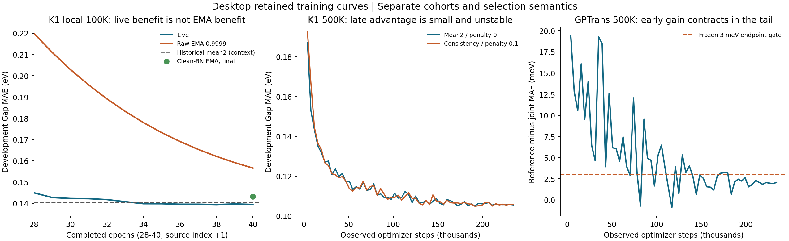

# Desktop RML and retained training-curve review

Review date:2026-10-13 JST. Desktop snapshot:b2b35d95. This is a metadata
review and route assessment, not a new experiment, terminal evidence package,
early-stop policy or release. Original contracts, results and decisions remain
unchanged. No graph, target or prediction tensor was loaded; no model, training,
inference or protected-role evaluation was executed.

## Recommendation from this review

Finish and accept the already-authorized mean2/live versus single-forward/EMA
500K pair before another unrelated K1 module. No reviewed alternative has a
stronger immediate release case. Keep single-forward/live and EMA state handling
as conditional alternatives; do not declare them adopted or launch them now.
Existing fusion is a useful complementary predictor, not evidence for a new
router, student or full-data run.

Kaggle1 kernel138365645/version2 was independently queried as RUNNING during
this review. Its latest API console was empty; actual native qualification and
formal training exposure were not yet observed. The exact owning contract and
receipts remain in `D:/w/k1-mean2-single-ema-500k-20261013`, linked by
[BRANCHES](../../BRANCHES.md). RUNNING is not accepted progress.

## 1. RML integrity and coverage

The existing `research_memory check --frozen --portable` passed. Main discovery
contains112 trajectories:106 desktop,5 historical and1 server-owned historical
record. The106 desktop trajectories cover59 owning question directories.
Counts:41 NO_TRAIN,24 NEGATIVE_UNDER_CONTRACT,19 INCONCLUSIVE,12 CLOSED,
8 POSITIVE_UNDER_CONTRACT,7 INFRASTRUCTURE_ONLY and1 ACTIVE. These are index
outcomes, not GPU-job counts or ready-to-submit model counts.

The pool contains7 `complete` and3 `historical_partial` entries in3 comparability
groups, plus21 exclusions. There are0 READY records and0 broken required
pointers. Complete replay means recoverable qualified evidence, not a positive
scientific gate. The8 positive trajectories include historical or diagnostic
outcomes; the later scale reassessment supersedes an old positive projection.

The completeness index reports81 trajectories unavailable for training-curve
backtesting. These include all41 NO_TRAIN records: absence of a training curve
there is expected. Other retained limits include20 historical-partial records,
78 incomplete native-cost measurements,11 records without cost events,
38 missing explicit role identities and12 trajectories without V5 evidence.
Frozen checks validate storage and publication; they do not prove that a
human-written interpretation obeys its scientific endpoint or cost gate.

Six selected mapped desktop owners contain24 additional owning trajectory IDs
absent from main discovery:5 NO_TRAIN and19 ACTIVE. This includes the current
500K pair and its failed first attempt, native execution work, cost/quality,
spectral and standalone EMA custody. Several ACTIVE records already have
terminal physical jobs and failed numerical gates; they await closure rather
than more compute. Keep unresolved canonical records on their mapped owners,
as BRANCHES requires. Do not merge active science merely to unify a count.

## 2. Local100K live/EMA claim needs correction

Authority:[protocol](../../experiments/pcqm_k1_single_true_ema_100k/protocol.md),
[result](../../experiments/pcqm_k1_single_true_ema_100k/result.json),
[raw40-row curve](../../experiments/pcqm_k1_single_true_ema_100k/trace.jsonl),
[canonical trajectory](../../experiments/pcqm_k1_single_true_ema_100k/trajectory.json).

| Retained state | Development MAE eV | Difference from historical mean2 |
|---|---:|---:|
| Historical mean2 |0.140257286|reference point|
| Best local live |0.139370188|0.887meV better, contextual|
| Local final live |0.139419958|0.837meV better, contextual|
| Selected raw EMA0.9999 |0.156532928|16.276meV worse|
| Selected EMA after clean BN |0.143099055|2.842meV worse|

The protocol names clean-BN EMA as its endpoint and rejects more than0.5meV
loss. That retained point fails the stated tolerance. Choosing the favorable
live score afterward changes weight/selection semantics; it cannot make the
declared EMA test pass. RTX5060 timing versus a historical T4 timing also cannot
pass the same-hardware speed gate. This is an unresolved qualification and
interpretation discrepancy, not permission to rewrite the original trajectory
as a finalized negative result without its missing terminal evidence.

The late curve reinforces the distinction. Over completed epochs30->40, live
improves2.830meV while raw EMA improves46.376meV but remains far worse. At the
same final epoch, clean BN recovers13.434meV of the17.113meV raw-EMA/live gap;
clean EMA still trails that live state by3.679meV. Learned-weight averaging,
buffer state and training horizon remain separate possible contributors.
Best live is raw source epoch37/completed epoch38; other records use different
epoch bases. The local trace lacks directly observed step/presentation fields.
Its31240-step axis is inferred from the runner's781 complete batches per pass,
not promoted to canonical observed exposure.

At decay0.9999, nominal EMA window is10000 steps and half-life6931 steps.
The initial-state coefficient after31240 updates is about4.397%; after234360
updates it is about6.63e-11. This algebra makes a scale/horizon question
reasonable, but guarantees neither accuracy benefit nor convergence.
The shared EMA also averages floating BN buffers; the earlier clean-BN
mechanism distinguishes output-state error from a proven training change.

The trajectory still has ACTIVE outcome, empty result evidence lists and only
a planned canonical cost event. Retained console/result timing is not the
missing observed role/cost/V5 package. CURRENT_STATE was corrected to describe
the evidence without changing historical raw files or the frozen500K payload.

## 3. What the earlier curves actually establish

Each100K arm below has40 epochs/31240 updates/3998720 presentations. The
consistency500K arms have60 epochs/234360 updates/29998080 presentations.
Epoch values alone are not cross-scale exposure coordinates.

| Question | Accepted effect and curve behavior | Route assessment |
|---|---|---|
| Native single versus mean2,100K |Single0.141294 vs mean2 0.140257; single error+1.037meV, rowCI[+0.180,+1.922]. Single still improves4.013meV over completed30->40, but the quality bound fails. Same-device fixed-fixture step saving49.225% passes its separate cost gate.|Second-forward workload is a real cost; quality-preserving replacement is not established.|
| Clean second view,100K |0.141020 vs0.140257; candidate is0.763meV worse, gainCI crosses zero. Both select epoch37;3meV gate fails.|Do not repeat this dropout-view change as a positive module.|
| Dropout consistency,100K |0.138729 vs0.140257;1.529meV gain, rowCI[0.616,2.349], below3meV gate. Tail changes are small.|A weak improvement is recorded; it does not justify another unqualified stack.|
| Consistency500K |Selected raw gain0.119meV and identical-clean-BN gain0.293meV; both row intervals cross zero and fail1meV gate. Mid-run advantage reverses; both selected at completed49.|The penalty is executed but supplies no material500K advantage. Removing it alone does not remove a forward pass.|
| Clean-fit49->60,500K |Consistency clean train MAE improves0.538meV, while clean development worsens0.787meV. Mean2 clean train improves1.270meV with development near-flat, CI crossing zero.|The observed tail does not support blanket insufficient-exposure or add-more-epochs advice. It does not uniquely prove overfitting.|
| Fixed-fusion output distillation |Strong beats weak3.111meV but beats consistency only0.433meV with CI crossing zero and remains3.630meV behind teacher. Both best at40 and still improve late.|Close these tested strengths. Missing teacher/objective traces prevent a causal explanation or calibrated longer-run promise.|
| Spectral residual,100K |0.141367 vs fresh reference0.141294; candidate is0.073meV worse; rowCI crosses zero and3meV gate fails. Both select40.|No material evidence for500K; a final-epoch best does not prove undertraining.|
| GPTrans joint Noisy Nodes/PairNorm,500K |First10 mean gain13.116meV, last10 2.024meV; selected gain2.056meV fails3meV. PairNorm adds only0.244meV over Noisy Nodes at scale.|Baseline catch-up is observed. A100K winner or early500K lead is not a transfer guarantee.|

Sources:[native single decision](D:/w/k1-t4-cost-quality/experiments/pcqm_k1_t4_cost_quality/terminal_acceptance/decision.md),
[clean second](../../experiments/pcqm_k1_clean_second_100k/terminal_acceptance/decision.md),
[dropout pair](../../experiments/pcqm_k1_dropout_consistency/terminal_acceptance/decision.md),
[consistency](../../experiments/pcqm_k1_consistency_ablation_500k/clean_bn/DECISION.md),
[later official closure](../../experiments/pcqm_k1_consistency_ablation_500k/clean_bn/rml_terminal_20261009/OFFICIAL_CLOSURE.md),
[clean fit](../../experiments/pcqm_k1_clean_fit_generalization_500k/terminal_decision.md),
[distillation](../../experiments/pcqm_k1_fusion_distillation/terminal_acceptance/attribution.md),
[spectral](D:/w/k1-spectral-night/experiments/pcqm_k1_spectral_100k/reconciliation_20261009/acceptance.md),
[GPTrans scale reassessment](../../experiments/pcqm_scale_transfer_reassessment/decision.md).

The same seed42 mean2 development curve recurs in three accepted experiments.
Distinct physical run IDs do not make identical seeds/cohorts independent
training-variance evidence. Online dropout training objectives, teacher-free
label losses and clean inference MAE are not interchangeable metrics.

The left panel shows only the local100K tail. The middle and right panels use
observed canonical optimizer coordinates. The500K axis alignment and source
SHA256 values were checked; no stopping rule or counterfactual saving was fit.
[Source manifest](review_assets/desktop_rml_review_sources_20261013.json)
preserves the plot/review provenance. Tiny console/float32/float64 differences
do not change any accepted gate.

## 4. Other routes and reuse limits

| Route | Evidence available | Submission implication |
|---|---|---|
| Capacity/slot/readout expansion |Fourteen retained K1 attenuations all worsen; slot/readout paths are used. Earlier width/slot/multiple-slot attempts are weak or negative; low representation rank does not prove exhausted capacity.|No evidence-led priority for another width/slot/relationship module now.|
| Clean BN state handling |Same parameters recover about1.245meV on500K; repeated clean passes are near-null, dropout during buffer estimation hurts. This is a frozen-inference effect.|Keep as a conditional state diagnostic; do not silently add it to the running contract.|
| True EMA / single-forward |Conflicting100K quality observations, a favorable but partial18-epoch clean500K EMA prefix, and no accepted complete500K endpoint. That old T4 run ended STOP_FOR_COST, not scientific success.|The running pair is the relevant next test. Its raw-EMA primary differs from the old clean-prefix primary.|
| Fixed K1/GPTrans fusion |Retained clean500K50:50 output0.098477eV,3.410meV better than GPTrans EMA on the same consumed cohort. Independent full-role fusion previously trailed accepted EdgeState.|Preserve complementarity; no automatic full release or new MoA/router.|
| More output distillation |The tested student loses materially to its teacher;500K train-role teacher predictions/strict teacher custody are not established by a development blend.|No blind strength retry or500K teacher stack.|
| Sequential pretraining |Historical K1 gain0.197meV and GPTrans-joint gain0.887meV, below3meV and with reference/cost gaps.|No proven pretraining ingredient to add by default.|
| Geometry |Legacy EdgeState point gain passes its own contract. Later V4 bridge completes but standalone K1/GPTrans and blend increments miss material gates.|Earlier bridge-blocker navigation is stale; this does not supply a new release.|
| GPTrans chemical auxiliary |Descriptor/fingerprint gains2.444/1.364meV, below3meV; best at last60 but native-cost/reference/physical-ID limits remain.|Late improvement is not a calibrated reason to extend or stack the loss.|

Additional authority:[complete K1 audit](../../experiments/pcqm_k1_complete_local_audit/analysis_zh.md),
[BN mechanism](../../experiments/pcqm_k1_bn_mechanism_a100/terminal_decision.md),
[bounded T4 prefix](D:/w/k1-colab-500k-efficient/experiments/pcqm_k1_single_ema_500k/t4_native/terminal_acceptance/decision.md),
[chemical custody](../../experiments/pcqm_gptrans_chemical_aux/terminal_custody_decision.md),
and the pretraining/geometry owners mapped by BRANCHES. Unreviewed owner edits
were not used as accepted promotion evidence. No server-owned live work was
adopted. Historical partial results are not thrown away or upgraded to strict
reference evidence.

## 5. Explicit decision branches after the authorized pair

1. Both complete and candidate clears its frozen3meV plus paired-row interval
   and mechanical/native/cost gates: nominate the cheaper recipe for separate
   review. This is not an automatic full-data or official-evaluation release.
2. Candidate is fast but the declared EMA endpoint misses quality: inspect
   retained final live/EMA states under a separately authorized saved-state
   diagnostic. Favorable live would isolate state handling as the next issue;
   unfavorable live would leave loss/regularization or other recipe effects
   unresolved. Do not declare single-forward failure from EMA alone.
3. A shorter EMA horizon or live selection becomes a justified training
   alternative only after that discriminator. Reuse the accepted same-contract
   reference; do not add an unrelated module or retrain it for bookkeeping.
4. Budget truncates either arm: accept common optimizer-step/presentation
   exposure only, retain STOP_FOR_COST/INCONCLUSIVE and actual assigned cost.
   No60-epoch, automatic continuation or whole-platform speed claim.
5. Input/native qualification fails: close the physical attempt honestly;
   no model conclusion follows from0 formal progress.

The review supports waiting for decision-relevant500K evidence while completing
existing metadata custody. It does not support an immediate second independent
GPU question, threshold relaxation, retrospective reference fabrication or a
successor submitted merely to keep hardware occupied.
