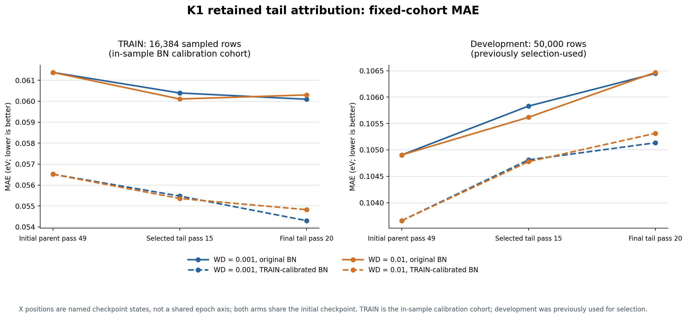

# K1 scale attribution and retained-tail discriminator

Accepted local NO_TRAIN evidence; no model adoption or new training.
The bounded investigation was authorized for 2026-10-25 05:41:35–07:41:35 UTC.

- [Scale synthesis](analysis.md): distinguishes variant-relative gains, cohort and
  reference changes, missing teacher transfer, output state and late regression.
- [Completed fixed-weight decision](attempt_002/terminal_decision.md) and
  [attribution](attempt_002/attribution.md): all five retained states reproduce;
  common Clean-BN does not remove worse development despite better TRAIN fit.
- [Interpretation review](interpretation_limits.md): confines the buffer claim
  to the tested calibration procedure and preserves frozen terminal bytes.
- [Frozen retry protocol](attempt_002/protocol.md), [result](attempt_002/results/result.json)
  and [completion](attempt_002/results/completion.json): actual CPU execution,
  predicates, costs and artifact hashes. This is not training replay readiness.
- [First failed diagnostic](terminal_decision.md): pre-forward import failure,
  actual role reads and incomplete timer evidence remain recorded separately.
- [Infrastructure incidents](infrastructure_review.md): exact compatibility and
  comparison-scope repairs, executed verification and its limits.
- [Technical target recovery](target_recovery/protocol.md): independent, bounded
  CPU qualification supplement for the existing negative tail training owner.
  Its receipts and subsequent qualification, not this diagnostic, determine
  whether the original training pair can enter strict replay.
- [Artifact custody](artifact_custody.json): 25 ignored tensors, 10,905,337 bytes,
  verified in external D: storage and the primary checkout. Recover exact bytes
  through the manifest; do not hydrate unrelated historical artifacts.

The figure uses categorical retained states, not an exposure-aligned learning
curve. Calibration TRAIN members also supply the in-sample metric. Development
members have already influenced historical selection. Conditional row intervals
do not estimate training-seed variability.

Source is retained on `codex/exp/k1-scale-attribution-20261025`; accepted diagnostic
evidence and reviewed reusable infrastructure follow BRANCHES' non-promotion
integration route. The original negative training question remains owned by
`codex/exp/k1-tail-regularization-500k` until its independent closure and custody.
