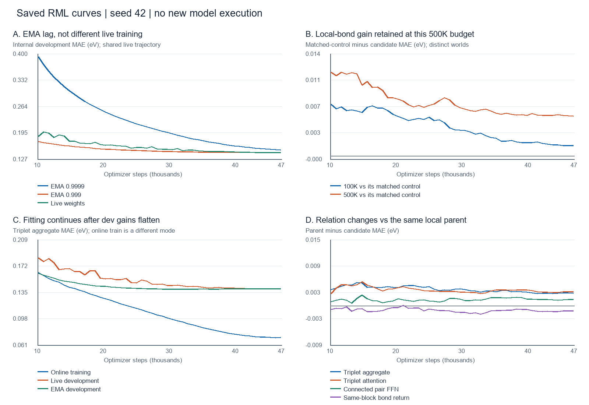

# RML curve-level research review — 2026-10-13

## Scope and conclusion

This was a retrospective analysis and literature/design review, not a compute
release, new scientific outcome, architecture implementation or terminal
trajectory. It preserved all historical gates and native decisions. No model,
checkpoint or graph cache was loaded; no training, inference, protected-role
access or compute-platform operation occurred.

The strongest actionable distinction was **useful explicit chemical communication
versus additional fitting freedom**, not simply small versus large models.
The real-bond local stream retained a substantial benefit in an accepted matched
500K run. Its subsequent triplet aggregate improved the original 100K benchmark,
but retained only uncertain benefit on a later molecular cohort. More attention,
node width, mean readout, relaxed decay and same-block bond feedback did not
establish further gains. A historical EMA lag explained another class of curves
without changing live training at all.

These observations do not identify a universal cause of 100K-to-full reversal.
They distinguish optimization/filter lag, cohort sensitivity, post-peak fitting,
and execution cost; each needs a different intervention.

## 1. Evidence coverage and reproducibility

The existing RML source validator passed before analysis. Replay was rebuilt
**in memory**, not written over repository-derived files. Source counts were:

| Record type | Count |
|---|---:|
| Trajectories | 96 |
| Evidence envelopes | 93 |
| Canonical traces | 55 |
| Cost records | 140 |
| Role records | 401 |
| Comparison prelaunch / post-run records | 58 / 42 |
| Reference bundles / target-transform assets | 16 / 3 |

The source-built pool contained **50 entries, 44 unique trajectories and nine
comparability groups**, supporting **41 candidate/reference curve comparisons**:
21 GPTrans and 20 K1/MetaGIN comparisons. Entry count includes reused reference
views; it is not an experiment or complete-loop count. Historical-partial
capabilities and null terminal labels remained unchanged. Excluded records are
listed in the analysis, not silently promoted.

Replay source digest:
`4e83f5882c686bab5e7c10feaa0f7b07aeef0e97098b1c127d56742ad26494e4`.

[Machine-readable review](curve_review_2026-10-13.json) retains source SHA256s,
trace hashes, comparison-world identities, native cost, original terminal labels,
all exact-step aligned curves and per-metric summaries. Two recent delivery
studies contribute four additional saved curve summaries **outside** the
architecture replay comparisons. NO_TRAIN diagnostic decisions were reviewed
separately; they are not new training pairs.

The offline reader is `molgap.research_curve_review`; it reuses RML validation,
replay admission and atomic serialization. Reproduction:

```powershell
.venv\Scripts\python.exe -m molgap.research_curve_review --repo-root . --output experiments/pcqm_v5_route_portfolio/curve_review_2026-10-13.json --figure experiments/pcqm_v5_route_portfolio/curve_review_2026-10-13.png
.venv\Scripts\python.exe -m pytest -q --noconftest tests/test_research_curve_review.py
```

### Comparison rules

- Only identical admitted comparison worlds are paired; optimizer steps and
  sample presentations must match exactly. No interpolation or extrapolation.
- Positive gain means reference MAE minus candidate MAE, **within that pair**.
  Absolute errors from different datasets/roles are not a common leaderboard.
- Curve minima use producer reductions. Accepted endpoint values below use the
  experiment's saved-prediction acceptance; tiny reduction differences are not
  contradictory outcomes.
- Online training, live development and EMA development are distinct evaluation
  modes. Equal units do not make their subtraction a clean generalization-gap
  estimate. Normalized loss is never subtracted from eV.
- The recorded `epoch_or_pass` coordinate is producer-owned: some historical
  traces are zero-based, others one-based, and the 500K trace uses fractional
  passes. The 60 observation rungs of that run were approximately 12 full passes.
- Row-bootstrap intervals describe the retained molecules, not seed variance.
  Repeatedly used development roles are not sealed independent confirmation.



The figure shows steps 10,000 onward to expose the late trajectory. Panel B
compares gains against each run's own matched control, not absolute 100K and
500K errors. Panel C keeps training/evaluation modes explicitly separate.

## 2. Recent GPTrans comparisons

This table preserves each experiment's comparator and scope. Approximate gains
are eV. A positive point estimate does not itself grant promotion.

| Intervention | Comparator | Selected gain | Curve-level interpretation |
|---|---|---:|---|
| Author-style degree scaling, G1 | Original input baseline, slow EMA | +0.005130 | Positive at all 60 aligned EMA observations; slow EMA still improving late. |
| Author-style bond-path mean, G2 | Same original input baseline | +0.004527 | Positive at all 60 observations; not proof of additivity with G1. |
| G1 + path mean | G1, slow EMA | -0.000247 | Only 26/60 favorable observations; combining input changes did not add benefit. |
| EMA 0.999 instead of 0.9999 | G1, identical live training | +0.006652 | All 60 favorable; live train/dev/LR/counters identical. Filter intervention, not architecture gain. |
| Path mean + corrected EMA | G1 + corrected EMA | -0.000780 | 11/60 favorable; EMA repair did not reveal a hidden path gain. |
| Real-bond local stream | G1 + corrected EMA | +0.001874 | 59/60 favorable; substantial early gain shrank; below its original material gate. |
| Node width 352 | G1 + corrected EMA | -0.002869 | 0/60 favorable; final training fit essentially unchanged despite much larger model. |
| FFN expansion | G1 + corrected EMA | -0.000283 | 10/60 favorable; small fit improvement did not establish dev improvement. |
| Atom-mean readout | G1 + corrected EMA | -0.000571 | 7/60 favorable; better training fit, worse selected dev point. |
| Bond-mean readout | G1 + corrected EMA | -0.002741 | 2/60 favorable; again, fit improved without dev benefit. |
| Weight decay 0.05 to 0.01 | G1 + corrected EMA | -0.002789 | Only 1/60 favorable; reduced clipping incidence did not repair endpoint quality. |
| Bias/1D no-decay groups | G1 + corrected EMA | -0.000466 | 3/60 favorable; interval did not establish improvement. |
| Uniform pair-depth scaling | G1 + corrected EMA | -0.002565 | 13/60 favorable; no evidence supporting a universal amplitude repair. |
| Original pair FFN transition | G1 + corrected EMA | +0.000223 | 34/60 favorable; final inserted transition was disconnected from the loss. |
| Path endpoint encoding | G1 + corrected EMA | -0.001387 | 9/60 favorable; did not repair relation encoding under this budget. |
| Local-stream amplitude cap | Uncapped local parent | -0.001028 | 9/60 favorable; cap activated increasingly but worsened selected dev. |
| Connected pair FFN | Local parent | +0.001367 | 60/60 favorable; connected all branches, but below the frozen material gate. |
| Same-block bond return | Local parent | -0.001193 | 3/60 favorable; connected feedback and stronger fitting were insufficient. |
| Triplet aggregation | Local parent | +0.003050 | 59/60 favorable; stable relative gain, followed by post-peak dev erosion. |
| Triplet attention | Local parent | +0.003043 | 57/60 favorable; no measured advantage over cheaper aggregation. |
| Local stream at 500K, equal updates | Retained matched 500K G1 control | +0.005650 | 60/60 favorable; advantage shrank but remained at the final observation. |

Numerical owners: the corresponding experiment decisions under
`experiments/pcqm_gptrans_*`, especially
[capacity/relations](../pcqm_gptrans_capacity_relations_100k/gpu/results/interpretation.md),
[local relations](../pcqm_gptrans_local_relation_100k/gpu/results/interpretation.md),
[triplet communication](../pcqm_gptrans_triplet_communication_100k/gpu/results/interpretation.md),
and [500K local transfer](../pcqm_gptrans_local_transfer_500k/gpu/results/interpretation.md).
The JSON provides exact source bindings for every comparison rather than relying
on names or copied scalar rankings.

## 3. Findings that change the next experiment

### 3.1 Scaling did not universally erase architecture gains

The accepted 500K local-stream endpoint was **0.1096073005 versus 0.1152574413**,
gain **0.0056501408**, with candidate-minus-reference paired 95% interval
**[-0.0061879503, -0.0051088837]**. Parameters increased 11.90%, from 5,246,817
to 5,871,201. Final live development also favored local communication, so this
was not only an EMA artifact.

At observations 10/20/30/40/50/60, the within-run EMA gains were respectively
0.014577 / 0.010483 / 0.007150 / 0.006428 / 0.005851 / 0.005650. This supports
both faster early learning and a retained advantage at the observed endpoint.
It does **not** establish a nonzero asymptotic advantage: both models selected
the final observation, at 46,860 steps / 5,998,080 presentations (~12 passes).

This is stronger scale evidence for the real-bond stream than another promising
100K plugin. The earlier below-gate 100K result remains historically unchanged.
It cannot be ranked against official-validation EdgeState numbers on a different
role or treated as a full-training win.

### 3.2 More training fit was often not the missing resource

At the selected EMA point versus the final point, saved online training values
and EMA development values were:

| 100K model | Online train at selected point → final | EMA dev selected → final |
|---|---:|---:|
| Real-bond local | 0.094091 → 0.074937 | 0.142358 → 0.142773 |
| Local + triplet aggregate | 0.096775 → 0.071324 | 0.139308 → 0.139945 |
| Local + triplet attention | 0.081343 → 0.071352 | 0.139315 → 0.139667 |

These are separate within-metric changes, not train/dev subtraction. The models
continued to fit training observations after the best development checkpoint.
That is consistent with a generalization/regularization limitation, not evidence
that these branches merely needed more epochs. It does not prove memorization,
which would require stronger matched functional evidence.

Conversely node352 ended with online train approximately 0.097137 versus its
reference's 0.097143: increasing to about 9.68M parameters did not improve
fitting at equal budget. Its failure cannot honestly be classified as established
overfitting. Optimization/capacity allocation remains unresolved for that arm;
blindly extending it is not justified either.

### 3.3 EMA produced a different, already localized failure mode

On G1, changing EMA 0.9999 to 0.999 improved selected dev by 0.006652 eV while
all observed live trajectories matched. Their half-lives were approximately
6,931 versus 693 optimizer steps: roughly 8.87 versus 0.887 100K epochs.
On the retained 500K live training, the two filters differed by approximately
0.009526 eV. Slow-filter improvement late in training therefore cannot alone
prove useful additional optimization or an architecture advantage.

The corrected 500K final EMA/live difference was only about 0.000027 eV.
Another EMA coefficient grid is not the leading hypothesis for the remaining
local/triplet gap. These observations do not authorize altering any frozen recipe.
Authority: [input/EMA decision](../pcqm_gptrans_input_ema_100k/gpu/results/decision.md).

### 3.4 The triplet portability gap existed before retraining

The [frozen-checkpoint portability assay](../pcqm_gptrans_triplet_portability/decision_terminal.md)
found aggregate gain **0.0030497763** on the original 50K role and
**0.0017669638** on the later 10K panel: 57.94% point retention, but the later
candidate-minus-parent interval **[-0.0037810024, +0.0001655305]** crossed zero.
Its preregistered consideration gate failed. No triplet 500K training occurred.

The original predictions reproduced and no optimizer update occurred. Thus
this attenuation necessarily has a cohort/sampling component; it cannot be
explained solely by reduced parameter exposure during expanded-data training.
The panel had already been used for research, so this was not fresh confirmation.

### 3.5 Existing diagnostics weaken easy mechanistic stories

The [source assay](../pcqm_gptrans_source_dependence/decision_terminal.md) found:

- Triplet real-conditional node source effective fraction 0.33849 → 0.33913
  between original/later panels; no broad later-cohort collapse.
- Triplet gated mass approximately 0.590–0.793, not a universally shut gate.
- Later mean graph size 13.80 → 14.51 atoms on these panels, but no causal
  size attribution or 21+ atom coverage.

The [bottleneck audit](../pcqm_gptrans_bottleneck_audit/decision_terminal.md)
confirmed gradients through all real-bond local blocks. The original final pair
FFN was disconnected; its connected successor obtained a small, below-gate
gain. That defect cannot explain the aggregate's portability loss, because the
aggregate branches themselves were connected.

Gradient presence establishes connectivity, not usefulness. RMS growth is not
proof of explosion; entropy is not functional reliance. Reference-error-ranked
subsets use targets and regression-to-the-mean effects: they are not chemical
specialists or a deployable Router.

### 3.6 Engineering speed and scientific quality remain separate

[Execution tuning v3](../pcqm_gptrans_execution_tuning40/decision_terminal.md)
qualified **1.133×** complete-stage throughput on its shared T4x2 allocation.
Its selected accuracy difference (-0.000679 eV candidate-minus-original) had
an interval crossing zero. Both 40-of-60 schedule arms selected the last point;
these cannot be substituted for completed 60-observation scientific runs.

Evaluation consumed 21.16% of optimized stage wall, checkpoint publication
approximately 0.15%. Preserve checkpoints; optimize data/evaluation reuse rather
than weaken durability. Original epochs sped up after the other worker exited,
consistent with shared CPU contention, so this is not a standalone GPU speed law.
The delivery finalizer limitation remained explicit: retained delivery evidence
was not forced into training Replay by inventing a causal comparison.

## 4. What the wider K1 history contributes

The other 20 Replay comparisons prevent overly optimistic interpretation of
small relation gains. Chemistry-typed PairToken, RRWP, receiver and several
triplet/degree variants had favorable original-100K curves. Their separate
frozen-cohort audits sometimes attenuated or reversed those gains. A scalar
winner on one repeatedly queried role was not reliably portable.

Linear attention and motif hierarchy had early favorable observations but worse
selected endpoints. MetaGIN had no favorable aligned EMA observation and fitted
training better while losing development performance. These do not support an
automatic longer-training rescue or another module-stacking exercise.

The already negative K1 multiplicative-pair-value experiment is specifically
relevant to the proposed relation-composition reserve below. It lowers confidence
in generic "multiplication adds expressivity" claims. A per-triangle recurrent
pair operation is a different hypothesis from a pooled global PairToken value,
but that distinction must be preregistered rather than used to disregard failure.

The corpus also contains infrastructure-only, diagnostic and incomplete
historical records. They inform limitations and failure prevention, not a common
MAE ordering or additional independent statistical replications.

## 5. Primary-paper reading: mechanism, ablation, configuration, applicability

Search terms were derived from observed weaknesses: `triplet gated aggregation
ablation`, `pair value fusion`, `edge transformer PCQM`, `EMA lag learning rate`,
and `molecular dual graph bond graph ablation`. This review favored a few
mechanistically relevant full methods over a large abstract catalogue.

### GPTrans — IJCAI 2023

[Paper](https://www.ijcai.org/proceedings/2023/0396.pdf), equations 3–10 and
section 4.4: node-to-node, node-to-edge and edge-to-node flows are distinct.
The matched ablation improved as these flows were added; deeper allocation also
outperformed wider allocation at similar parameters. This motivates examining
information routing rather than raw width. Our model already implements all
three flows: proposing "add edge-to-node" would repeat existing code, not fix a
missing path. Published recipes/model sizes and training budgets are not our
100K contract, so their scores do not predict our gain.

### TGT — ICML 2024

[Paper](https://arxiv.org/html/2402.04538v2), section 3.1, tables 9/10 and appendix
D.1: direct pair-to-pair exchange can use gated aggregation or query-dependent
attention. Attention was more expensive and better on the paper's distance
objective; our direct-Gap comparison did not reproduce an accuracy advantage.
Triplet-weight dropout and source dropout are different operations. The former
regularizes individual interactions; the latter removes shared attention sources.
The published top score also used geometry prediction/pretraining and other
stages, not merely one triplet block. No teacher, geometry stage or stochastic
inference is imported by this proposal. Source-collapse diagnostics do not
justify source dropout as a measured repair.

### Edge Transformer — NeurIPS 2024

[Conference paper](https://proceedings.neurips.cc/paper_files/paper/2024/file/e5419147e53eba322cf12aff266a66f2-Paper-Conference.pdf),
equations 1–4, tables 4/6: its value is a channelwise product of two composed
relations, not just one relation vector with a scalar third-pair weight.
PCQM ET/ET+RRWP reported 0.0840/0.0832 at 16.8M parameters, with 10 layers,
384 width, BS256 and two million training steps. This is motivation, not a
budget-matched result. Full ET has cubic costs and a specific tokenization for
its 3-WL theorem. A compact GPTrans addon is neither that replica nor entitled
to that theorem; its measured cost and gain must stand independently.

### EMA dynamics — TMLR 2024

[Paper](https://arxiv.org/html/2411.18704v1), sections 3–4: the useful averaging
window interacts with learning-rate dynamics; an EMA curve can peak and then
approach live weights as optimization slows. This fits the observed need to
separate live convergence from filter lag. The experiments mainly concern
image classification/SGD, not a molecular AdamW coefficient prescription.
Our matched-filter evidence is stronger than transferring a numerical beta from
another task. No fresh coefficient grid is proposed.

### DGT — Nature Communications 2026, reserve only

[Publisher](https://www.nature.com/articles/s41467-026-75005-9), figures 1/3 and
the indexed architecture/ablation text describe atom and line-graph bond branches,
cross-feature fusion, and optional geometry. Bond-branch removal worsened QM9
orbital prediction; topology/ring and geometry contributions were separate.
The [author implementation](https://github.com/zhangsy-ryan/DGT) confirms the
dual-graph design. Full publisher methods/PDF and Cambridge downloads were not
reliably retrievable during this review; exact configuration and all confounds
were not audited. Therefore this is a **partially reviewed reserve**, not a
ready-to-submit or fully reproduced proposal. No 3D benefit is claimed for our
pure-2D task.

## 6. Code-level weak-point localization

Inspection of `src/molgap/gptrans.py`, `gptrans_capacity.py`,
`gptrans_local_relation.py` and `gptrans_triplet_communication.py` established:

1. The GPTrans parent has persistent 32-dimensional pair state. Its attention
   update is projected through eight heads, but this does **not** prove the
   entire recurrent pair representation has rank eight or has collapsed.
2. The successful 64-channel real-bond block is a transient message MLP over
   source node, receiver node and current pair state, summed into the receiver
   before each GPA block. It is **not** an independent persistent 64-dimensional
   EdgeState branch. GPS9/RWSE16 are not automatically present in this GPTrans.
3. The triplet aggregate returns a weighted sum of another pair's projected
   value. Its scalar source bias/gate is distinct from channelwise composition
   of two relation values. Added query/key attention did not help on this task.
4. The failed bond-return arm updates true-bond pair entries and recomputes the
   local message in the same block. It is not a sparse persistent bond-to-bond
   line-graph memory, but it is a real negative warning against redundant feedback.
5. The inserted triplet branches have no additional stochastic regularization
   in the inspected implementation. Their connectivity was measured; their
   sensitivity to interaction-specific regularization was not.

## 7. Ranked modifications — hypotheses, not released jobs

### Priority A: aggregate-branch-only triplet regularization

**Question:** can the aggregate retain its useful relation communication while
reducing late fitting that fails to improve development?

- Keep the accepted local+aggregate architecture, insertions, gates, readout,
  shared backbone dropout, EMA, optimizer, fixed data, BS128 and FP32 unchanged.
- Change only train-time triplet-weight dropout, with one prospectively frozen
  probability (e.g. 0.10, a design hypothesis, not an inferred optimal value).
  No probability grid and no stochastic inference.
- Use the exact accepted aggregate as the primary immutable reference, not a
  weaker G1 scalar. The local parent remains contextual evidence.
- Preserve independent RNG for the new mask, including checkpoint/resume state,
  so it does not silently change backbone dropout or sample order. Zero-dropout
  equivalence must be verified before release.
- Expected extra inference parameters: zero. Runtime and training cost still
  require measurement. Declare the stochastic intervention honestly in the
  prospective contract; do not claim an unchanged scientific fingerprint if
  a governed field changes.

This is a **generalization hypothesis**, not a repair for measured source
collapse. A win requires better selected development and credible portability,
not merely lower train loss or a larger apparent train/dev gap. If both later
portability and original endpoint fail, close it without a dropout grid.

### Priority B: channelwise relation composition, retaining the local parent

**Question:** does the missing information lie in the value being transmitted,
rather than in more attention parameters?

Retain the aggregate's scalar routing and inward/outward topology. Replace its
one-relation value with a low-width product of both participating relations:

```text
existing:     sum_k a(i,k) * V(P(j,k))
proposed:     sum_k a(i,k) * [U(P(i,k)) elementwise V(P(j,k))]
```

Use the analogous outward operation and the same zero-initialized output/branch
locations. Freeze widths and parameter budget before compute; do not add heads,
global slots, geometry, readout or auxiliary objectives simultaneously.

This borrows the ET value-fusion idea while deliberately keeping the existing
aggregate routing. It is not full triangular ET attention or a claim of 3-WL
equivalence. A contraction implementation must avoid materializing an
`N x N x N x channels` value tensor; matrix products can avoid that activation,
but still incur cubic arithmetic. Measure cost before authorizing training.

Primary comparator: unchanged accepted aggregate. The old failed K1
multiplicative-value route is required counterevidence. Stop if value composition
only improves fit, loses frozen-role portability, or violates the frozen cost
budget. This is lower confidence than Priority A but more mechanistically
distinct than attention/width/FFN additions.

### Reserve C: persistent sparse bond-to-bond memory

The successful real-bond stream suggests a possible independent chemical
relation state, updated along incident-bond/line-graph neighborhoods, then
communicated to atoms. Unlike same-block bond return, its defining intervention
would be persistence and bond-to-bond communication, not another immediate pair
feedback projection.

Do **not** submit this from the current review. First finish DGT methods/config
audit and reconcile earlier directed-EdgeState and motif failures. Do not import
ring encoding, a new readout, geometry and a second transformer simultaneously.
New topology indices require an accepted CPU cache or a separately qualified
deterministic representation adapter. The proposal remains a reserve because
its evidence and implementation cost are weaker than A/B.

### Separate scale question: retention beyond the positive 500K endpoint

The highest-value unresolved scale question is whether the accepted local-stream
gain survives further **matched** exposure. This already has an owning
[revised contribution proposal](../pcqm_gptrans_local_transfer_500k/late_contribution_plan.md);
do not recreate its superseded 24-pass proposal or submit a candidate-only
continuation.

That local document records desktop's completed 60-full-pass local package:
selected EMA 0.1018876901 at pass50, final 0.1022721455. It does not contain an
equivalent no-local control, and entire runner/recipe equivalence and retained
reference evidence have not been qualified for strict server reuse. This was
read as existing documentary context, not newly independently accepted desktop
evidence or a cross-machine live operation.

The proposal first qualifies that retained local result, then trains **only the
missing no-local arm**, from matching initial tensors under the exact 60-pass
recipe. Its 234,360 steps and warmup differ from the server's 46,860-step bridge;
the two scalar scores cannot isolate exposure. If reference qualification fails,
hold release rather than automatically repeat the local model. Preserve the
existing explicit budget decision and no-desktop-custody boundary. Historical
12-pass positivity does not itself release continuation or full training.

## 8. Screening and RML requirements for any subsequent experiment

Use the existing family/addon workflow, frozen packaging, release validation,
runtime qualification and terminal pipeline. Only the differing mechanism should
need new model code. This report is not permission to alter common infrastructure.

Before compute, bind comparator, purpose/intervention, source/init identities,
fixed asset/rows/target transform, roles, allowed exposure, endpoint selection,
cost ceiling and the **experiment-specific** material/portability gates. V5 does
not make historical 0.003 eV a universal immutable threshold; equally, no old
gate may be relaxed after seeing its result. Select a new gate prospectively
from material benefit and cost, not from this retrospective ranking.

Required records include prospective plan → receipt/runtime → exact step and
presentation curves → immutable chunks/checkpoints → accepted predictions and
paired analysis → native cost/roles → terminal decision → actual replay admission.
The later-role audit must have its own prospectively frozen identity and
NO_TRAIN closure, using the full canonical role required by screening policy,
not a fresh convenient random 10K sample. Keep its diagnostic status separate
from the training Replay pair. Repeatedly used roles remain development evidence.

For weak-point analysis, record train-unit semantics, live/EMA metrics, LR and
EMA windows, exposure counters, selected/final checkpoints and bounded module
gradient/update summaries. A small fixed input-only clean-train probe can clarify
fit versus online augmentation/dropout, but would be an explicitly planned
additional diagnostic, not an invented retrospective measurement. Avoid expensive
every-step instrumentation or target-selected subsets.

Default discovery remains one seed42 screen. No automatic extra seeds, full
training, teacher, 3D branch, protected evaluation or desktop job control follows.

## 9. Recommended disposition

1. Retain the accepted real-bond local-stream 500K evidence as a genuine positive
   matched-budget result, with unresolved later convergence.
2. Prefer aggregate over added triplet attention: they were effectively tied,
   while attention cost more in its observed run.
3. Prepare Priority A only after freezing its intervention/comparator and cheap
   equivalence checks; Priority B is the next independent hypothesis if needed.
4. Keep C as a documented reserve, not a speculative overnight submission.
5. Do not reopen width, cap, mean readout, same-block feedback or a general decay
   grid without new evidence.

Focused offline-review tests passed (7). RML source validation passed. These
checks do not certify proposed model code, remote runtime or future Replay
readiness. Existing user edits and canonical/derived RML files were preserved;
no cloud upload, monitor change or remote job was created.
